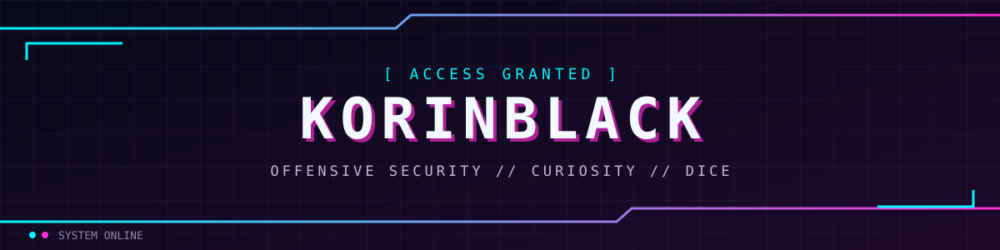
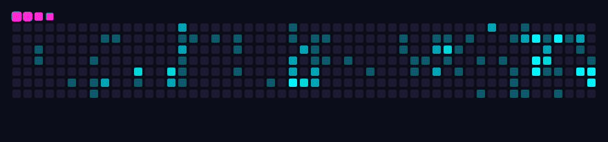
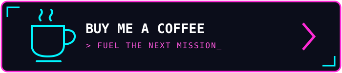

<div align="center">



[](https://github.com/KorinBlack)

[](README.md)
[](README.ita.md)

`PENTEST` · `HOMELAB` · `CTF` · `GDR`

</div>

## `> whoami`

**Ciao, sono KorinBlack.** Lavoro nella cybersecurity come penetration tester, dopo un'esperienza da SOC analyst. Mi piace capire come funzionano le cose, metterle alla prova e imparare qualcosa di nuovo lungo il percorso.

```ini
[operatore]
ruolo      = Penetration Tester
prima      = SOC Analyst  ; dal blue team al red team
approccio  = "rompilo per capirlo"
lingue     = IT, EN
stato      = online ▮
```

## `> load interests`

| | Interesse | |
|:--:|:--|:--|
| ⚔️ | **Hacking & CTF** | esplorare, sperimentare e risolvere sfide |
| 🖥️ | **Homelab** | costruire, rompere, imparare, ripetere |
| 💻 | **Programmazione** | trasformare la curiosità in codice |
| 🎲 | **Giochi di ruolo da tavolo** | storie, strategie e tiri di dado |

## `> ls ~/arsenal`

<div align="center">

[](https://skillicons.dev)

</div>

## `> credentials --list`

<div align="center">


</div>

<details>
<summary><code>> cat ./mission-log.txt</code></summary>

```diff
+ [ OK ] Partito dal SOC — analisi degli alert, caccia alle anomalie
+ [ OK ] Cambio di campo — sicurezza offensiva e penetration testing
+ [ OK ] OSCP+ ottenuta
! [ .. ] Sempre in corso: esperimenti in homelab, CTF, nuovi strumenti
- [ ?? ] Prossima missione: tiro per l'iniziativa…
```

</details>

## `> trace --contributions`

<div align="center">



</div>

## `> refuel`

<div align="center">

Se quello che creo ti è utile, puoi offrirmi un caffè. ☕

<a href="https://buymeacoffee.com/kannone"></a>


`[ FINE TRASMISSIONE ]`

</div>
