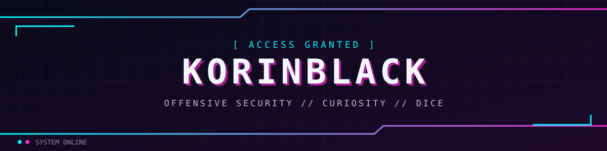
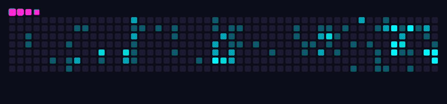
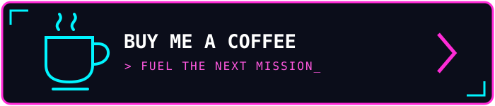

`[ IT / EN ]` · `PENTEST` · `HOMELAB` · `CTF` · `TTRPG`

## `> whoami`

**Ciao, sono KorinBlack.** Lavoro nella cybersecurity come penetration tester, dopo un'esperienza da SOC analyst. Mi piace capire come funzionano le cose, metterle alla prova e imparare qualcosa di nuovo lungo il percorso.

**Hi, I'm KorinBlack.** I'm a cybersecurity professional and penetration tester with a background as a SOC analyst. I enjoy understanding how things work, putting them to the test, and learning something new along the way.

## `> load interests`

| | Italiano | English |
|:--|:--|:--|
| ⚔️ | **Hacking & CTF** — esplorare, sperimentare e risolvere sfide | **Hacking & CTFs** — exploring, experimenting and solving challenges |
| 🖥️ | **Homelab** — costruire, rompere, imparare, ripetere | **Homelab** — build, break, learn, repeat |
| 💻 | **Programmazione** — trasformare la curiosità in codice | **Programming** — turning curiosity into code |
| 🎲 | **Giochi di ruolo da tavolo** — storie, strategie e tiri di dado | **Tabletop RPGs** — stories, strategies and dice rolls |

## `> credentials --list`

Certificazioni e attestati · Certifications and course completions

## `> trace --contributions`

## `> refuel`

Se quello che creo ti è utile, puoi offrirmi un caffè. ☕  
If you find my work useful, you can buy me a coffee. ☕

`[ END OF TRANSMISSION ]`

